

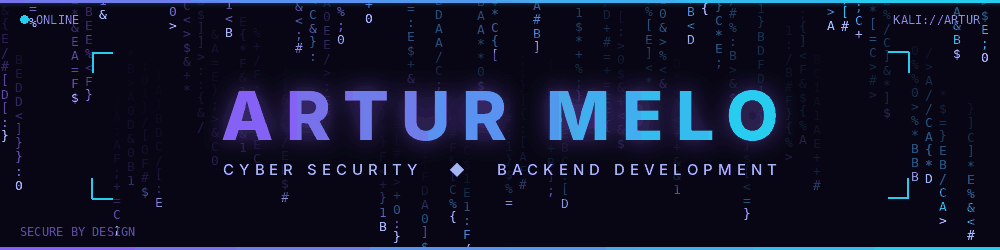

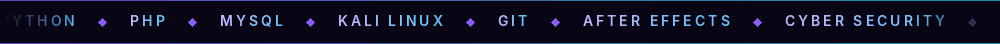

 

  

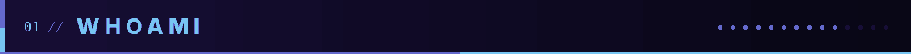

 

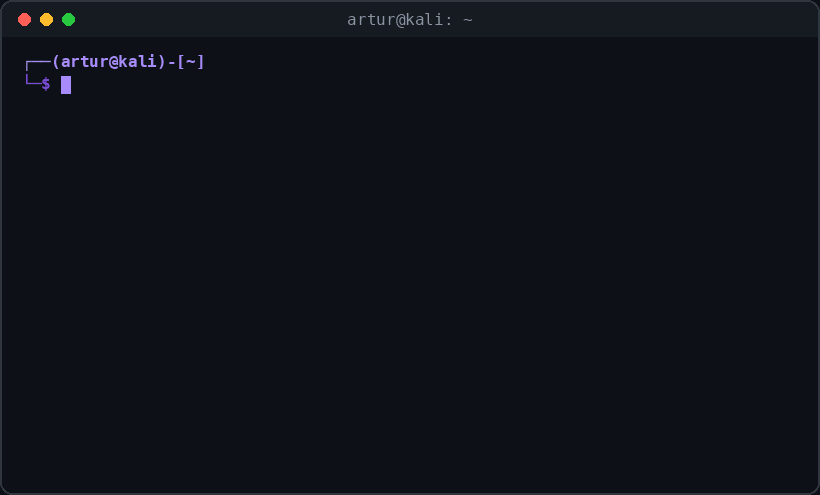

  

<table align="center">
  <tr>
    <td align="center" width="40%">
      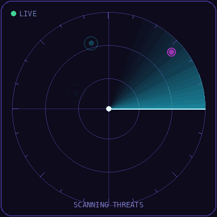
    </td>
    <td width="60%">
       
      Protecting applications, data and users from the ground up.
        
       
      Clean, reliable and scalable server-side logic.
        
       
      Motion graphics to bring ideas to life.
    </td>
  </tr>
</table>

 

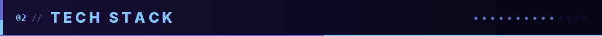

 

<b>LANGUAGES &amp; DATABASE</b>
 

<b>SECURITY &amp; SYSTEMS</b>
 

<b>CREATIVE</b>
 

  

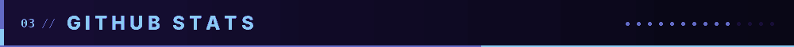

 

  

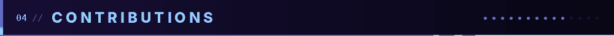

 


 

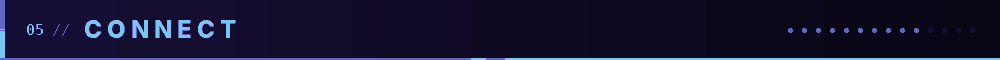

 

  

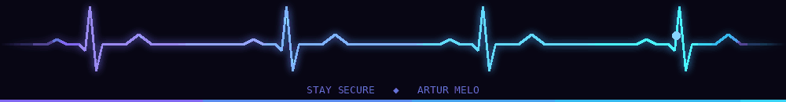

