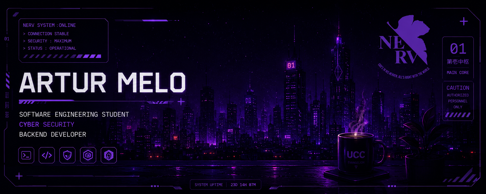

<div align="center">



<br>


<a href="https://github.com/Melopjl">
  
</a>

<br><br>


</div>

<br>


<div align="center">

## ⟨ whoami ⟩

</div>

```bash
┌──(artur㉿kali)-[~]
└─$ cat about.txt

  Name      : Artur Melo
  Focus     : Cyber Security • Backend Development
  Stack     : Python, PHP, MySQL
  System    : Kali Linux
  Creative  : After Effects
  Mindset   : Building secure systems.

┌──(artur㉿kali)-[~]
└─$ echo $PHILOSOPHY

  Security is not a feature, it's the foundation.
```

<br>

<table align="center">
  <tr>
    <td align="center" width="33%">
      <h3>🛡️ Security</h3>
      <sub>Protecting applications, data and users from the ground up.</sub>
    </td>
    <td align="center" width="33%">
      <h3>⚙️ Backend</h3>
      <sub>Clean, reliable and scalable server-side logic.</sub>
    </td>
    <td align="center" width="33%">
      <h3>🎬 Creative</h3>
      <sub>Motion graphics to bring ideas to life.</sub>
    </td>
  </tr>
</table>

<br>


<div align="center">

## ⟨ Tech Stack ⟩

<br>

<sub><b>LANGUAGES &amp; DATABASE</b></sub>
<br>


<br>

<sub><b>SECURITY &amp; SYSTEMS</b></sub>
<br>


<br>

<sub><b>CREATIVE</b></sub>
<br>


</div>

<br>


<div align="center">

## ⟨ GitHub Stats ⟩

<br>


</div>

<br>


<div align="center">

## ⟨ Connect ⟩

<br>

<a href="https://github.com/Melopjl">
  
</a>
<a href="https://linkedin.com/in/SEU-USUARIO">
  
</a>
<a href="mailto:SEU-EMAIL@exemplo.com">
  
</a>

<br><br>

> *Building secure systems.*


</div>
